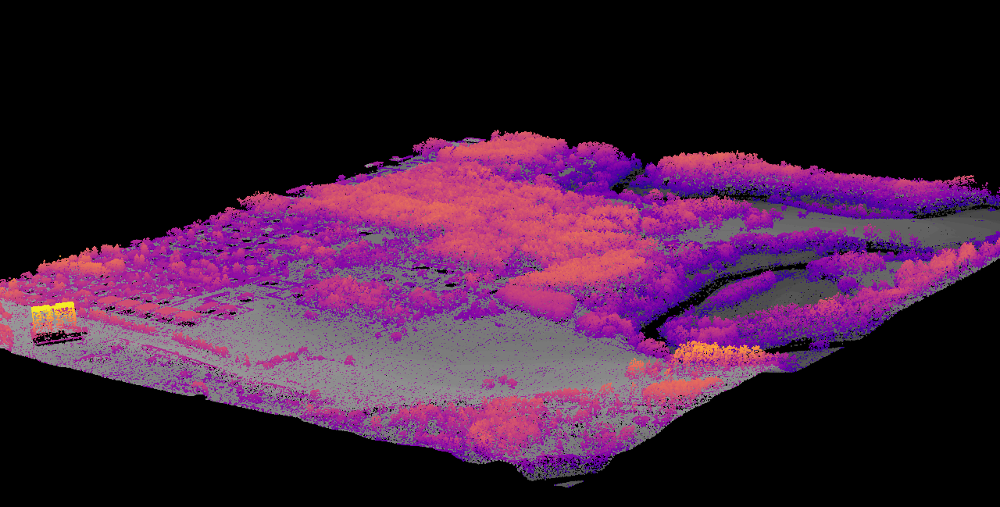

  

# Hi, I'm Alexandra 🌋

I'm a Geoscience graduate and MSc GIS & Remote Sensing
student.  I use GIS, LiDAR, multispectral and radar
remote sensing to study the Earth and beyond.

**Currently:** #30DayMapChallenge 2026 

**Tools:** QGIS · ArcGIS Pro · Python  · R (lidR) · Sentinel-1/2

⚡ Fun fact: my undergrad dissertation measured CO₂ trapped in tiny melt inclusions, to work out why a usually calm volcano erupted explosively
